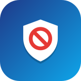
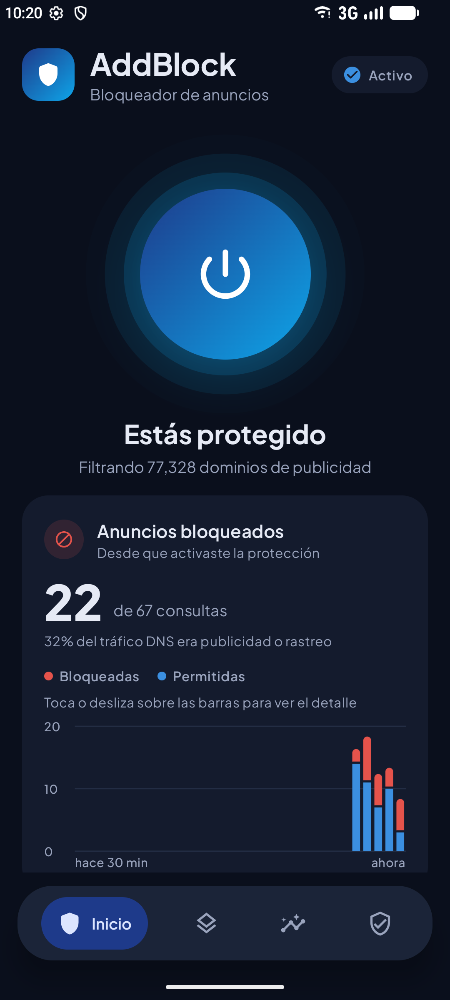
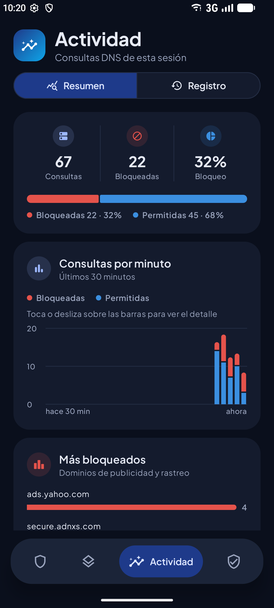
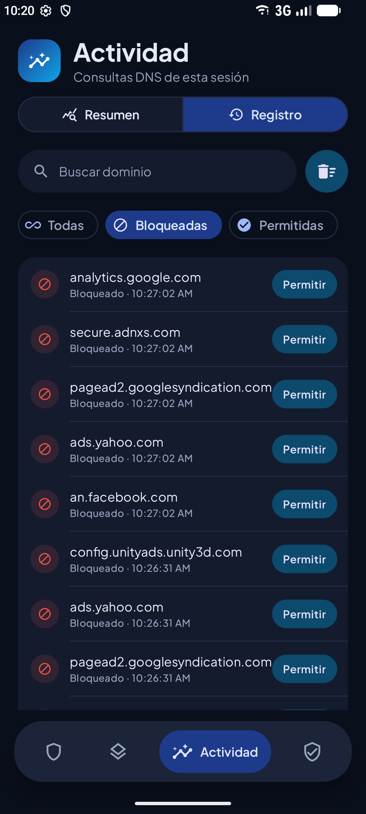
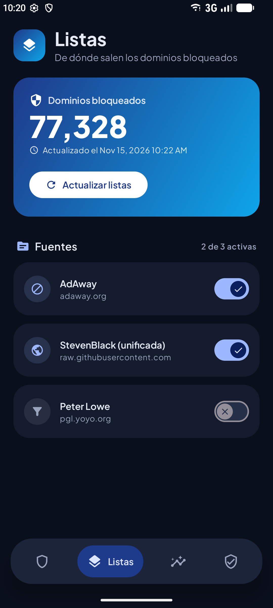
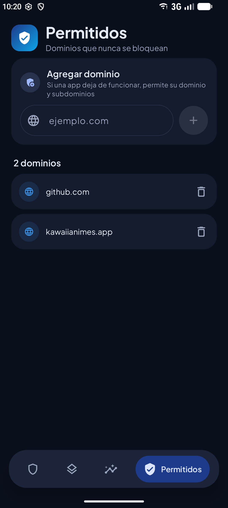
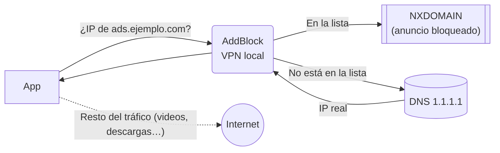

<div align="center">



# AddBlock

**Bloqueador de anuncios para Android, sin root.**
Bloquea la publicidad y los rastreadores de todas tus apps filtrando las consultas DNS con una VPN local.

[](https://github.com/Riosan575/AddBlock/releases/latest/download/AddBlock.apk)

[](https://github.com/Riosan575/AddBlock/releases/latest)


</div>

---

## Capturas

<div align="center">
  
  
  
  
  
</div>

## Características

- 🛡️ **Bloqueo en todo el sistema**: funciona en todas las apps y navegadores, no solo en uno.
- 🔓 **Sin root**: usa la API `VpnService` de Android, igual que el modo sin root de AdAway.
- ⚡ **Ligero**: solo pasan por la app las consultas DNS; el resto de tu tráfico va directo a internet. El APK pesa ~1.4 MB.
- 📋 **Listas conocidas**: AdAway, StevenBlack y Peter Lowe, con más de 77 000 dominios de publicidad y rastreo. Se actualizan con un toque.
- 📊 **Estadísticas en tiempo real**: anuncios bloqueados, tasa de bloqueo, consultas por minuto y ranking de los dominios más bloqueados.
- 🔎 **Registro de actividad**: cada dominio consultado, con búsqueda y filtros.
- ✅ **Lista de permitidos**: si una app deja de funcionar, permite su dominio con un toque.
- 🔁 **VPN siempre activa**: compatible con la opción de Android para encenderse sola al reiniciar.
- 🌙 **Tema claro y oscuro** con diseño Material 3.

## Instalación

1. Descarga **[AddBlock.apk](https://github.com/Riosan575/AddBlock/releases/latest/download/AddBlock.apk)** desde la [página de releases](https://github.com/Riosan575/AddBlock/releases/latest).
2. Ábrelo en tu celular. Si Android lo pide, permite **instalar apps de fuentes desconocidas** para tu navegador o gestor de archivos.
3. Abre AddBlock y toca el botón de encendido.
4. Acepta la **solicitud de conexión VPN**. La primera vez se descargan las listas de bloqueo (unos segundos).

> [!TIP]
> Para que el bloqueo se active solo al reiniciar el celular, ve a **Ajustes → Red → VPN → AddBlock** y activa **VPN siempre activa**.

## Cómo funciona

Las apps preguntan al DNS la dirección de cada servidor antes de conectarse. AddBlock crea una VPN local que solo intercepta esas preguntas: si el dominio está en las listas de publicidad, responde que no existe y el anuncio nunca se descarga. Las demás consultas se reenvían a un DNS público.



Solo se enruta por la VPN la dirección del DNS falso (`10.111.222.2`), así que tu navegación no pasa por la app ni se hace más lenta.

## Limitaciones

| Situación | Qué pasa |
|---|---|
| **Anuncios de YouTube, Instagram o Facebook** | No se pueden bloquear por DNS: se sirven desde los mismos dominios que el contenido. Bloquearlos rompería la app. |
| **DNS privado** en Ajustes de Android | Si está configurado con un proveedor (por ejemplo `dns.google`), Android se salta el filtro. AddBlock lo detecta y te avisa. Usa *Automático* o *Desactivado*. |
| **Otra VPN activa** | Android solo permite una VPN a la vez. |
| **Apps con DNS propio** | Las apps que usan DNS cifrado por su cuenta (DoH) no pasan por el filtro. |

## Privacidad

- No hay analíticas, anuncios ni cuentas.
- El registro y las estadísticas viven solo en la memoria del celular y se borran al cerrar la app.
- La app solo se conecta a internet para descargar las listas de bloqueo y para reenviar las consultas DNS permitidas a `1.1.1.1` (Cloudflare) o `8.8.8.8` (Google).

## Arquitectura

Clean Architecture organizada por *features*. Cada feature tiene sus capas `domain` (modelos, interfaces de repositorio y casos de uso), `data` (implementaciones) y `presentation` (ViewModel + pantalla en Compose). Las dependencias se inyectan a mano desde `AppContainer`.

```
app/src/main/java/bendev/addblock/
├── core/
│   ├── di/            AppContainer y fábrica de ViewModels
│   ├── dns/           Parseo y armado de paquetes IPv4 / UDP / DNS
│   └── ui/            Componentes compartidos y barra de navegación
├── feature/
│   ├── protection/    VpnService, filtrado de paquetes y pantalla de inicio
│   ├── blocklist/     Descarga y carga de las listas hosts
│   ├── querylog/      Registro, estadísticas y gráficos
│   └── allowlist/     Dominios que nunca se bloquean
└── ui/theme/          Colores, tipografía y tema Material 3
```

**Tecnologías:** Kotlin · Jetpack Compose · Material 3 · Coroutines y Flow · `VpnService` · R8.

## Compilar desde el código

Requisitos: **Android Studio** (o JDK 21+) y el Android SDK con la plataforma 37.

```bash
git clone https://github.com/Riosan575/AddBlock.git
cd AddBlock
./gradlew assembleDebug        # APK de prueba en app/build/outputs/apk/debug/
./gradlew testDebugUnitTest    # tests unitarios
```

Para un APK **release** firmado, crea un `keystore.properties` en la raíz del proyecto (está en `.gitignore`):

```properties
storeFile=keystore/addblock-release.jks
storePassword=••••••
keyAlias=addblock
keyPassword=••••••
```

y ejecuta `./gradlew assembleRelease`.

## Créditos

- Inspirado en [AdAway](https://github.com/AdAway/AdAway).
- Listas de bloqueo: [AdAway](https://adaway.org/hosts.txt), [StevenBlack/hosts](https://github.com/StevenBlack/hosts) y [Peter Lowe](https://pgl.yoyo.org/adservers/).
- Tipografía [Plus Jakarta Sans](https://fonts.google.com/specimen/Plus+Jakarta+Sans) (SIL Open Font License).

<div align="center">
<br/>
Hecho por <a href="https://github.com/Riosan575">Riosan575</a>
</div>
